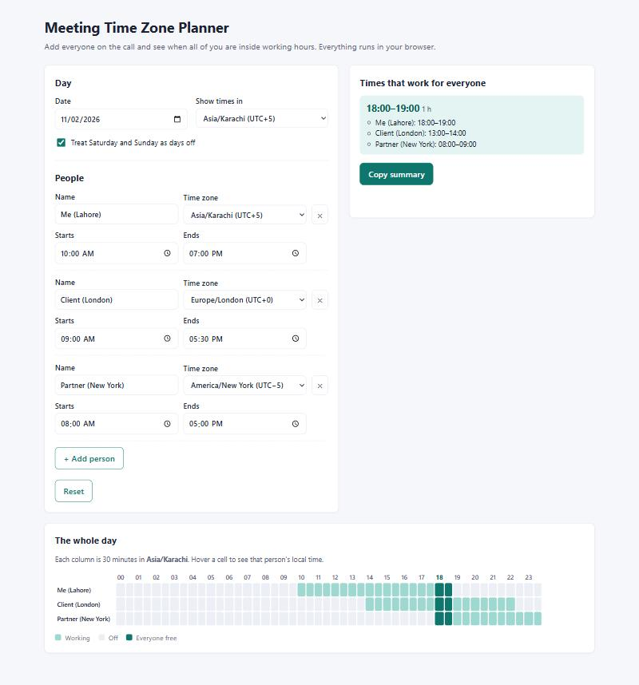

# Meeting Time Zone Planner

A small, dependency-free web app that finds the hours when everyone on a call is inside their working day. Add each person with their time zone and working hours, pick a date, and it lists every window that works for all of you, in each person's own local time, with a colour-coded timeline of the whole day. It is aimed at anyone booking calls across countries (sales teams, agencies, freelancers with overseas clients) who is tired of doing time-zone maths in their head and getting it wrong around daylight saving. Everything runs in the browser; nothing is sent anywhere.

## Screenshot



## Features

- Any number of people, each with a name, time zone and working hours
- Every IANA time zone your browser knows, labelled with its UTC offset on the chosen date
- Lists every window where everyone is free, with its length and the local time for each person
- Timeline of the whole day in 30-minute columns: working, off, and everyone-free at a glance
- Handles daylight saving, half-hour zones (India, for example) and shifts that run past midnight
- Option to treat Saturday and Sunday as days off, checked in each person's own time zone
- Copy summary to clipboard, ready to paste into an email
- Settings saved in your browser (localStorage) and a Reset button
- Responsive down to 375px, keyboard accessible, no frameworks, no build step

## How to use

Open `index.html` directly in a browser. That's it.

If you prefer serving it locally (for example so the clipboard API is available in every browser), run:

```bash
npx serve .
```

and open the URL it prints.

## A worked example

Three people on Monday 2 November 2026, with times shown in Karachi time:

| Person | Time zone | Working hours | Offset that day |
| --- | --- | --- | --- |
| Me | Asia/Karachi | 10:00 – 19:00 | UTC+5 |
| Client | Europe/London | 09:00 – 17:30 | UTC+0 |
| Partner | America/New_York | 08:00 – 17:00 | UTC−5 |

Converted to Karachi time, the client works 14:00 – 22:30 and the partner works 18:00 – 03:00. The only stretch all three share is **18:00 – 19:00 Karachi**, which is 13:00 – 14:00 in London and 08:00 – 09:00 in New York.

Daylight saving matters here. A week earlier, before the clocks went back in the UK and US, London was UTC+1 and New York UTC−4, so the same hours would land at different times. The planner works out each offset for the date you pick, so you don't have to remember who changed their clocks when.

## Run tests

Requires Node.js 20 or newer. There are no dependencies to install.

```bash
npm test
```

Tests use Node's built-in `node:test` runner and cover UTC offsets (including half-hour zones and daylight saving), converting local times to UTC, overlap windows, days with no overlap, shifts that cross midnight, weekends, the 25-hour day when clocks go back, and rejection of invalid input.

## Project structure

```
.
├── index.html                Page markup
├── styles.css                Styles
├── app.js                    UI wiring, timeline, localStorage, clipboard
├── timezones.js              Pure time-zone logic (no DOM)
├── tests/
│   └── timezones.test.mjs    Unit tests
├── docs/
│   └── screenshot.jpg        Screenshot used in this README
├── package.json
├── LICENSE
└── README.md
```

`timezones.js` is a plain script that registers `globalThis.TimeZones`. That lets the page load it with a normal `<script>` tag (so it works from `file://`, where ES modules are blocked) while the tests load the same file with `import`. Time-zone data comes from the browser's built-in `Intl` API, so there is no database to keep up to date.

## License

MIT © 2026 Socialist Fox. See [LICENSE](LICENSE).
